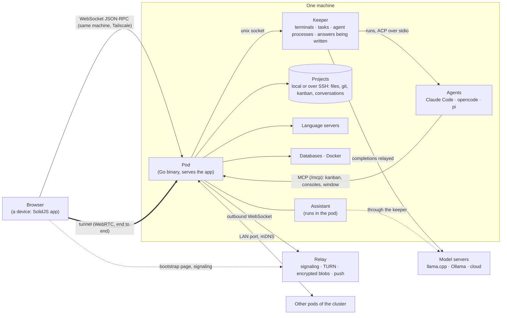

# Architecture

How Web IDE is built, where things live, and the traps already met. Read [spec.md](spec.md) for the intended behaviour.

## Overview

The system map, in the words of the [glossary](../../GLOSSARY.md):



Each part of the map has a README with the map of its own code:

- Pod: [pod/README.md](../../pod/README.md) and [pod/packages.md](../../pod/packages.md): server and protocol, files and processes (keeper, consoles, saved commands), AI (assistant, agents), kanban and git, network and identity (relay, tunnel, cluster); the language servers, the databases, Docker, the search, the port forwards and the previews are [built-in plugins](plugins.md).
- Browser: [web/README.md](../../web/README.md) and [web/src/README.md](../../web/src/README.md).
- Relay: the `relay` package, in [Network and identity](../../pod/packages.md#network-and-identity).
- Browser tests: [e2e/README.md](../../e2e/README.md).

The front end is built by Vite and embedded in the pod binary (`pod/webdist`), so the page and the WebSocket share one origin: no mixed content, and pairing is a cookie.

The documentation is embedded the same way (`pod/docsdist`, a copy of `docs/`, `GLOSSARY.md` and the READMEs of the code made by `scripts/embed-docs.sh`, since `go:embed` cannot reach `../docs`), so a pod installed from a release has the docs of its version, offline. The pod serves it read only (`docs.read` for a page, `docs.image` for a picture; paths are those of the repo and cannot leave the copy) and the window shows it in a `doc` tab (`ui/DocView.tsx`, `state/docs.ts`). The places of the interface that have a page are listed once, in `web/src/help/topics.json`, and checked by `scripts/check-links.mjs`.

The local terminals run in a second unit, the **keeper** (`web-ide-pod keeper`, installed as `~/.local/lib/web-ide/web-ide-keeper` and the unit `web-ide-keeper.service`): it spawns them, holds their PTY and their output numbered by offset. The pod talks to it over `<data>/keeper.sock` and can restart freely: when it opens a project again, it adopts the terminals the keeper still runs for it (their console id, title and kind travel as metadata of the process) and the page attaches again from the offset it has. Without a keeper (tests, `-keeper off`, no socket), the pod runs the terminals itself and they end with it. Language servers stay in the pod.

For an SSH project the keeper opens its own connection (`keeper/ssh.go`): the pod dials first and checks the host key (first use, its questions), then gives the keeper that key, pinned, and the secrets of the connection (kept in memory). The terminals and the commands of the assistant of the project run on it (target `ssh:<key>`); the pod builds their remote command.

The keeper updates itself without losing its processes (`keeper/upgrade.go`): `web-ide-pod keeper -upgrade` (or `SIGHUP`) has it re-execute its binary in the same process. Its processes stay its children; their PTY masters and pipes and the listening socket cross the exec as inherited descriptors, the output rings, the metadata and the ended HTTP requests go through `keeper-state.json`. What cannot cross waits: the HTTP requests in flight and the SSH commands are waited for (10 min by default, `-force` cancels them), the SSH terminals are closed. A failed exec leaves the keeper as it was. `install.sh` stops the pod, updates the keeper this way when its protocol changed, then starts the pod.

The keeper also relays HTTP requests (`keeper/http.go`): the completions of the assistant go through it (`llm.Relay`), so the answer being written is kept outside the pod. The conversations running are listed in `<data>/running.json`; a pod that stops saves nothing more, and the next one takes them back before it listens (`server/assistant_resume.go`): the completion awaited is read again from the relay (the parser replays it from the start, the model is not asked again), the command of a tool call that ran in the keeper (`bash` as a piped process, `run_command` in its console) is followed again until its deadline, the other tool calls without result run again (an approval is asked again). A run whose stream the keeper does not have is closed as interrupted, as without keeper.

## Repository layout

| Path | Content |
|---|---|
| [`pod/`](../../pod/README.md) | The pod: `main.go` (flags, wiring, subcommands), its [packages](../../pod/packages.md) one folder each, `webdist/` (embedded front end), `docsdist/` (embedded docs) |
| [`relay/`](../../relay/README.md) | The relay, run by the same binary (`web-ide-pod relay`): its package, `relayload/`, the bootstrap page (`web/`) |
| [`lib/`](../../lib/README.md) | The Go code the pod and the relay share: `identity`, `tunnel`, `i18n` |
| `go.mod` | One Go module for `pod/`, `relay/` and `lib/` (`github.com/DrSmithFr/web-ide`) |
| [`web/`](../../web/README.md) | The front end (SolidJS + TypeScript, Vite), [`src/`](../../web/src/README.md): the shell of the page and the plugin API |
| [`plugins/`](../../plugins/README.md) | The built-in plugins, one folder each: `plugin.json`, its Go package, `web/` (its page module), `e2e/` (its suites), `README.md` |
| `package.json` | npm workspaces (`web`): one `node_modules` at the root, so the page and `plugins/*/web` share `solid-js` |
| [`e2e/`](../../e2e/README.md) | Browser tests (Playwright core driving headless Chromium); `e2e/shots/` makes the pictures of the documentation |
| `claude-mod/` | Claude Code mod: ticket and changed files above the prompt, opened in the IDE (`/open`) |
| `docs/` | User guide, specification, architecture, kanban, doodle and relay designs, pictures (`docs/images`) |

**Target layout** (decided 2026-10-20, milestone *Repository layout*, before the external plugins). Done: one Go module at the root; `pod/` the pod program (no `internal/`: plugins import its packages), `relay/` the relay (still the `web-ide-pod relay` subcommand of one binary), `lib/` the code both share (#132); a root `package.json` (npm workspaces), `web/` the shell of the page, `plugins/<id>/` each built-in plugin in the shape of an external one, `e2e/` the harness and the suites of the core (#133); the business code of docker, the databases, the language servers, the search, the port forwards and the previews in their plugin, the core and the plugins reaching it through the capabilities of `pod/caps` (#134, #137). Decided on 2026-10-23: **Explorer, Editor and the consoles stay core and locked** (`pod/console`, `pod/commands`, decision 6 of [plugins.md](plugins.md)). Next: the rest of the business code (kanban, llm…), the dependencies of `runtime` and `server` inverted; later a catalog per plugin (`plugins/<id>/i18n/`).

## Data on disk

- `~/.web-ide/` (pod data, `-data` flag): `keeper.sock` (socket of the keeper, 0600), `keeper-state.json` (only during an update of the keeper), `running.json` (conversations running, taken back by the next pod), `config.json` (address, projects folder, relay, `lan`: the LAN listen address and the peers typed by hand), `token`, `device.key` (0600, the Ed25519 seed of the pod as a member; the name dates from before the glossary) and `identity.json` (its certificate, the pinned account key, the last revocation list — no phrase, no account key), `lan.crt` / `lan.key` (0600, the self-signed TLS certificate of the LAN port), `push.json` (0600, the push subscriptions of the browsers and their choices), `projects.json`, `settings.json` (with history), `clipboard.json` (clipboard history), `desks/<project>.json` (desk 1: layout, tabs, tool zones, explorer options, the state of each plugin under `plugins`, a plugin tab with its own `state`, and per file the cursor, folds and chosen indentation), `desks/<project>@<n>.json` (desk n), `desks/<project>.desks.json` (the desks: number, name, mode; and the Recent Files they share), `secrets.json` (0600), `known_hosts` (trust on first use, in addition to `~/.ssh/known_hosts`), `sql-history/`, `llm.json` (model servers), `system-prompt.md` / `plan-prompt.md` / `briefing-prompt.md`, `models/hf/` (speech models), `agents/<project>/<id>.json` and `.log` (sessions of the Agents tool: thread, ACP session id, keeper process and output offset; error output of the agent), `agents/<project>/turns.jsonl` (the turns of the agents: time, waits, tokens per model; kept after the session), `prices.json` (prices per model added by the user, $ per million tokens: `{"model": {"input", "output", "cacheRead", "cacheWrite"}}`), `acp/` (npm prefix of the ACP adapters installed by the IDE), `chats/` and `kanban/` (bases of SSH projects), `icons/<project>.svg` (copy of the project icons for the home page: an SSH project is not reached to list it), `sync/base-<kind>.json` (the last state this pod synced, per kind) and `sync/conflicts-<kind>.json` (the entries changed on both sides, waiting for the user).
- `<project>/.ide/` (wholly ignored by git: its `.gitignore` is `*`, written by `idedir.Ensure` whenever the pod writes there; a worktree uses the `.ide` of its main project, `Runtime.IdeDir`): `connections.json` (database connections, no secret), `commands.json` (saved commands of the Console), `plugins.json` (the plugins disabled on the project, `{"disabled": [...]}`: every other one is enabled), `forwards.json` (port forwards of an SSH project; `tunnels.json` before #96, read and moved when `forwards.json` is missing), `folders.json` (folder marks: source, tests, excluded), `project.json` (`lsp`: command per language; `tests`: pattern per extension, e.g. `{".php": "{name}Spec.php"}`), `chats.db` (conversations), `kanban.db` (tickets), `worktrees/` (one git worktree per ticket in development), `icon.svg` and `icon.json` (project icon, drawn by the page: `ui/projectIcon.ts`, `ui/IconEditor.tsx`). `.ide/.gitignore` keeps the bases and the worktrees out of git.

## Protocol

JSON over one WebSocket per window. Request `{id, method, params}` → response `{id, result | error}`; events pushed as `{event, data}` (`fs.changed`, `buffer.synced`, `session.changed`, `console.output`, `lsp.diagnostics`, `git.changed`, `llm.delta`, `assistant.update`, `agents.changed` / `agents.entry` / `agents.append`, `questions.changed`, `kanban.changed`, `plugins.changed`…). The methods of a plugin are named `<plugin>.<method>` and refused on a project where it is disabled; `plugins.list` and `plugins.set` read and change the plugins of the project ([plugins.md](plugins.md)). `id: 0` is a notification without answer; `$/cancel` cancels a request. Some methods run in order per group (document changes, terminal input), and a language server request waits for the document changes sent before it (`barrier` in `server.go`).

`POST /mcp` is the MCP endpoint for Claude Code and the CLI agents (`server/mcp*.go`, JSON-RPC over HTTP without streaming, the token as a bearer): prompts on the kanban, tools on the saved commands, the tools of the plugins offered to the MCP only (`Host.MCPTool`: the `kanban_*` tools of the Kanban and the AI), and tools of the IDE (`mcp_ide.go`: consoles, previews, and what a window shows, run there through `ui.call` like the window tools of the assistant), and the assistant tools of the plugins (Docker's; all of them listed, since the endpoint serves every project; a call is refused where its plugin is disabled), see [kanban.md](kanban.md#claude-code). `/open?path=&line=` opens a file in the windows of its project (`server/open.go`).

Errors carry a code (`error`, `canceled`, `auth_required`, `db_password`) and a message translated into the language of the window.

## Pod (`pod`)

The packages, their roles, their maps and their pitfalls are in the READMEs of the code: [pod/README.md](../../pod/README.md) (the pod, `main.go`, the blocks) and [pod/packages.md](../../pod/packages.md), one section per block:

- [Server and protocol](../../pod/packages.md#server-and-protocol): `server`, `runtime`, `store`, `settings`, `projects`, `desks`, `idedir`, `config`, `update`, `plugins`; `i18n` (`lib/`)
- [Files and processes](../../pod/packages.md#files-and-processes): `fsx`, `execx`, `sshx`, `sshtest`, `console`, `keeper`, `clipboard`, `commands`
- [AI](../../pod/packages.md#ai): `assistant` (the tool kit), `hfcache`; the model servers, the conversations, the engine of the assistant and the CLI agents are the AI plugin's (`plugins/ai/llm`, `engine`, `acp`)
- [Kanban and git](../../pod/packages.md#kanban-and-git): `git`; `kanban` is in `plugins/kanban/kanban`
- [Network and identity](../../pod/packages.md#network-and-identity): `relayclient`, `multipod`, `lan`, `pair`, `settingsync`, `push`, `power`; and, outside `pod/`, `relay` and `relayload` (`relay/`), `tunnel` and `identity` (`lib/`)

## Front end (`web/src`)

The folders, their roles, their maps and their pitfalls are in [web/README.md](../../web/README.md) and [web/src/README.md](../../web/src/README.md). What spans folders and the pod follows.

### Assistant

- The assistant runs in the pod, in the AI plugin (`plugins/ai/assistant*.go`, its engine `plugins/ai/engine`, the tool kit `pod/assistant`): the turn loop without step limit, the tools on the runtime of the project (a worktree for a development), compaction (automatic past a threshold, manual, or asked by the model; all keep the last 10 steps, and each compaction stays as a card with its summary), Orchestrator / Build / Plan / Briefing modes (the Orchestrator tools in `plugins/ai/assistant_orchestrator.go`, `engine/orchestrator.go`, `plugins/kanban/kanban/day.go`), `ask_user` and plans (the turn stops until the user answers), the message queue, resume from the last completed step (`assistant.resume`) or retry from the user message (`assistant.retry`), both with the model chosen when it differs from the one of the conversation (a third button, "Resume with <model>"). A conversation goes on with no window open; several run at once, each model server running `parallel` of them (1 by default) while the others wait in a queue. Sub-agents (`plugins/ai/assistant_sub.go`, `assistant/subagents.go`) are conversations with a `parent`: their events reach the other side through `deliver` (queued while it runs, kept while it waits for the user, else added and the conversation started), always outside the locks of the runs; a run that ends with messages queued meanwhile starts again. An Orchestrator adopts a conversation of its own (`agent_adopt`): `assistant.Adopted` keeps its tools (plus `agent_note` / `agent_report`, no nudge to report) and its prompt says it is followed; events sent to it run it where it works (`runProject`).
- The pod is the only writer of a running conversation: every change is saved and sent as `assistant.update` (state, fields, messages from an index) to the windows of the project and of its worktrees; the answer being written is followed with `llm.attach`. Changes and commands that need the user wait in the pod (`approval`, answered by `assistant.approve` from any window), with an `assistant.attention` event. `open_file` and `focus` run in a window of the project (`assistant.ui`, answered by `assistant.ui.result`), the one showing the conversation first.
- `llm/assistant.ts` is the client: it shows the conversation from these events and sends what the user does (`assistant.send`, `assistant.answer`, `assistant.plan`, `assistant.stop`…), with the options of the page (apply without asking, thinking, compaction, Plan model, active file, Docker profiles). Module-level state (`llm/state.ts`) survives panel switches.
- `plugins/ai/engine/texts.go`: the default templates of the modes and the instructions of the roles of a ticket; `llm/prompt.ts` shows them in the settings (the pod builds the prompt: `assistant.prompt`). The project and `/tmp` (`assistant.Scratch`) are the free zone: file changes in it apply directly, the others are confirmed with a diff unless "apply without asking" is on; the assistant writes out of the project directly (`save`), the runtime keeping such files read-only for the editor. Build mode runs freely the shell commands that touch nothing out of the zone (`StaysIn`: reading commands anywhere, the others run in it, redirect into it and take paths in it; the body of a here-document is input, not commands; a quoted argument is one word; `bash -c` and `eval` are checked on their command; the commands inside `for`/`if`/`while` are checked, a variable assigned a literal earlier in the command is that literal and `$((…))` a number, while one assigned from `$(…)` still asks); Plan, Briefing and Orchestrator change only scratch files in `/tmp` and run freely the reading commands, the build, test and lint commands of the project and the commands confined to `/tmp` (`RunsFreely`); any other command asks (`pod/assistant/commands.go`). A path is in a zone as written or once its symlinks are resolved (a project opened as `~/Apps/x` with `~/Apps → /data/apps` is also `/data/apps/x`). The server tests use another scratch folder, their projects being in `/tmp`.
- Speech recognition runs in a Web Worker (transformers.js, WebGPU or WebAssembly); model files come through the pod cache.

### Kanban

See [kanban.md](kanban.md). A ticket worktree is registered as a hidden child project `<parent>-t<n>` (`projects.PutChild`); its kanban and conversations are those of the parent. Another worktree opened from the menu bar is a child project `<parent>-w<hash of its path>` (`projects.PutWorktree`, `server/handlers_worktrees.go`). Project windows are named `project-<id>` so that opening a project again brings back its window.

A window opens one project on one of its desks (`project.open {id, desk}`: the session of that desk and the desk list; `window.desk` on the pod). `session.update` writes the desk of the window and `session.changed {session, desk}` reaches the windows of the same desk only (`emitDesk`); `desk.switch` changes the desk of the window without reopening the project, `desks.update` saves the list (`desks.changed` to every window of the project, the session of a removed desk deleted), `session.get` / `session.put` read and write another desk (a tab sent there). The page keeps the desk in the URL (`app/router.ts`, `state/desks.ts`); tools and consoles are tab kinds (`tool`, `console`) rendered by `EditorArea` from the registry of `state/tiles.ts` (the Grid and Scroll modes, directional focus, resize, the launcher of `ui/tileLauncher.ts`; the columns of the Scroll mode are the children of a row split at the root of the tree, each with its `width`, shown by `ui/ScrollArea.tsx`; a console alone opens at `/project/:id/console/:consoleId`); the project page is keyed on the project id only, so a desk switch keeps the page and its documents. A window opens one project (`project.open`: its session) and attaches the other worktrees of the repository it shows (`project.attach`, `state/project.ts`): the runtime of each stays open while the window lives. A request names the worktree it runs in (`project` beside `method`; the server hands the handler a `Client` view with that project), and the events of an attached runtime reach the window tagged with their `project`. The page picks the worktree of a request in one place (`setScope`): the worktree of the file for `fs.*`, `git.*`, `lsp.*`, `buffer.*` and `folders.*` with a path (the deepest attached root holding it), none for the session, the database connections and the worktree list, else the worktree shown; consoles remember theirs (`requestIn`). `project()` and `root()` are those of the worktree shown, `home()` the project of the window. A ticket conversation records the project it works in (`ticket.project`) and keeps it (`runProject`).

## Languages

- The interface is translated with `t()` (`web/src/i18n`): the English text is the key, `fr.json` gives the French one, `{name}` marks a parameter and `tn()` picks the plural. A key may carry a context (`'menu|Edit'`) when one English word has two translations. Data tables keep English labels and are translated where they are shown. The languages are listed once, in `web/src/i18n/languages.json` (English, French, Spanish); the language is a setting (`language`: auto or one of them), auto follows the browser.
- Each window tells the pod its language (`client.lang`); errors created with `i18n.New` / `i18n.Errorf` are translated when they are sent (one catalog per language in `lib/i18n/`, listed by `i18n.Languages`; `i18n.Detect` reads `Accept-Language` for the pages the pod writes). Lines of the history of a ticket are stored as `{"key", "params"}` and translated by the page.
- Text read by the model (system prompt, tool descriptions and results) is always English; the model answers in the language of the user.
- `npm run check` and the Go tests of `lib/i18n` fail on a missing or extra key in any language. The e2e suites run in English (`E2E_LOCALE` to change it); the `i18n` suite checks French, Spanish and the switch.

## Building and testing

```
make build          # front end (Vite) then pod binary bin/web-ide-pod (front end embedded)
make dev            # pod with -allow-remote on 0.0.0.0:4434 and data in ~/.web-ide-dev + Vite on 0.0.0.0:5173 (hot reload)
make shots          # pictures of docs/images, replaying e2e/shots/recording.json.gz (see docs/guide.md)
make service        # this build as a systemd user service started at boot (scripts/install.sh)
make deploy-relay   # this build on the hosted relay: built for Linux x86_64, installed, service restarted, served Service Worker checked (scripts/deploy-relay.sh)
make deploy-relay RELAY_VERSION=v1.11.0   # a published release instead of this tree
make deploy-relay RELAY_ROLLBACK=1        # back to the previous binary on the relay host
make test           # gofmt + go vet + go test (pod/ relay/ lib/) + tsc + the identity test vectors run in JS + links and paths of the docs
make e2e            # browser tests, all suites, in parallel workers
./e2e/run.sh git    # one suite (the list is in e2e/run.sh); -j 1 runs the suites one by one
```

- Each e2e suite gets a fresh pod with temporary data and a workspace copied from `e2e/fixtures`; a suite ending with `+` reuses the previous pod. The suites run without keeper, but `keeper`: `run.sh` starts one next to its pod and gives it the script restarting the pod (`E2E_RESTART_POD`). The assistant suites use a scripted fake OpenAI-compatible server. Chromium comes from the Playwright cache or `CHROME=…`; the `speech` suite downloads `whisper-tiny` once (kept in `~/.cache/web-ide-e2e/models`); the `lsp` suite needs `gopls`; the `docker` suite needs Docker with Compose and the `postgres:17-alpine` image (skipped otherwise); the `forwards` suite builds `sshtestd` (Go) and opens an SSH project on it. `e2e/bin` (first in the `PATH` of the pod) holds fake `claude`, `claude-agent-acp` (an ACP agent in node, also used by the Go tests of `plugins/ai/acp`), `gh` and `tailscale` commands: the `preview` suite keeps its previews on `127.0.0.1`.
- `run.sh` runs the suites in `-j N` workers (`E2E_JOBS`, default a quarter of the CPUs, 8 at most), longest first: each chain (a suite and the `+` ones after it) is a `run.sh -j 1` with its own temporary folder and block of 100 ports from `E2E_PORT_BASE` (21000: pod, +1 relay, +2 TURN, +3 the fake push service, +20 LAN). `perf` runs alone at the end. A suite must therefore take its ports from the `E2E_*_PORT` variables or `listen(0)`, and name what it creates outside its folder (Docker projects, volumes) after its pid. The output of a failed suite is printed at the end, its pod log copied to `/tmp/web-ide-e2e-<suite>.pod.log`.
- Optional database driver tests against real servers: `WEBIDE_TEST_PG=host:port:user:pass WEBIDE_TEST_REDIS=host:port:pass go test ./pod/db/`.
- Code navigation needs the language servers in the pod's `PATH` (`gopls` also needs `go`). The unit keeps the `PATH` of the shell that installed it.
- Versions: `make build` stamps the binary with `git describe` (`web-ide-pod -version`, shown on the home page). Pushing a tag `v*` runs `.github/workflows/release.yml`, which builds the Linux and macOS archives and publishes the release with the notes of that version in `CHANGELOG.md`; `scripts/install.sh v1.2.3` installs one as the service.

## Pitfalls

The pitfalls of one area are in its README: [pod](../../pod/packages.md) (git, tunnel, identity, settings sync, LAN, multi-pod, power, relay pages), [web/src](../../web/src/README.md) (editor, Solid, DOM, clipboard, mouse), [e2e](../../e2e/README.md). The ones that span areas stay here.

- **Shell**: never `pkill -x web-ide-pod` nor `pkill -f web-ide-pod`: the pod of the IDE (the unit, which runs the assistant and its conversations) has the same name and dies with it, and `-f` also matches the keeper (`web-ide-keeper keeper`), which ends every terminal. Restart the pod with `systemctl --user restart web-ide-pod` only, and update the keeper with `web-ide-keeper keeper -upgrade`, never `systemctl --user restart web-ide-keeper`: a restart ends every terminal. Kill a test pod by the PID you kept (`$!`); `pkill -f <pattern>` also kills the command running it. Start a test pod with `setsid` / `< /dev/null`, otherwise a pipe stays open.

## Known limitations

- Code navigation was tested with gopls only; intelephense, phpactor, pyright and typescript-language-server were never tried.
- Tested in Chromium only.
- SSH was tested with the in-memory test server, not against a real host; ticket worktrees on SSH projects are untested. The Docker tool of an SSH project is untested (only its port forwards, through the test server).
- Global search uses RE2 syntax (no lookbehind).
- SQLite on an SSH project goes through the `sqlite3` command on the host (autocommit only).
- The microphone needs a secure context (localhost or HTTPS): with `-allow-remote` over plain HTTP, dictation is disabled (audio files are still transcribed).
