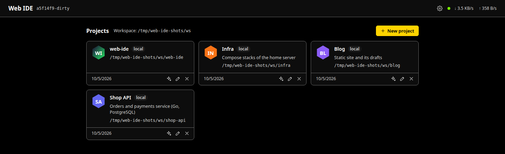
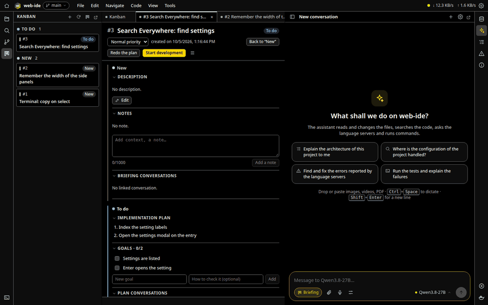
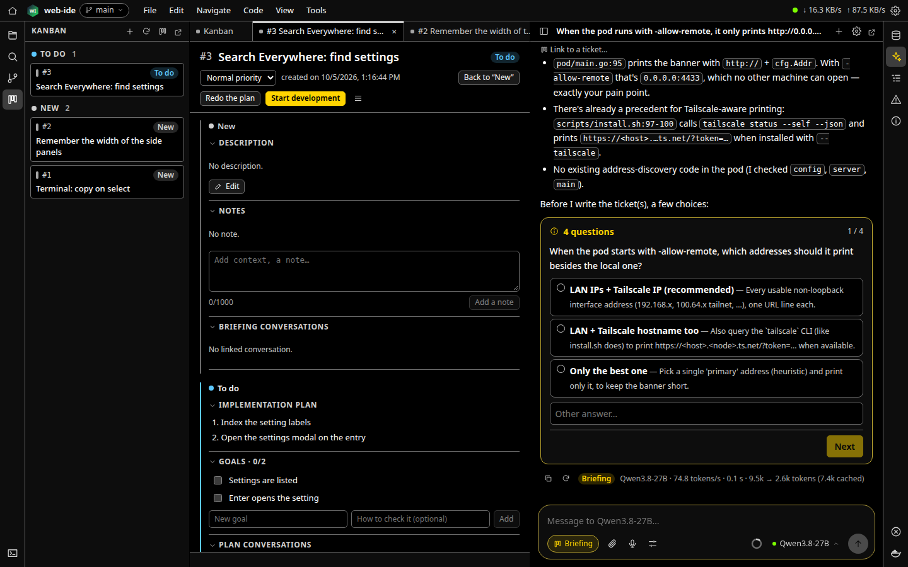
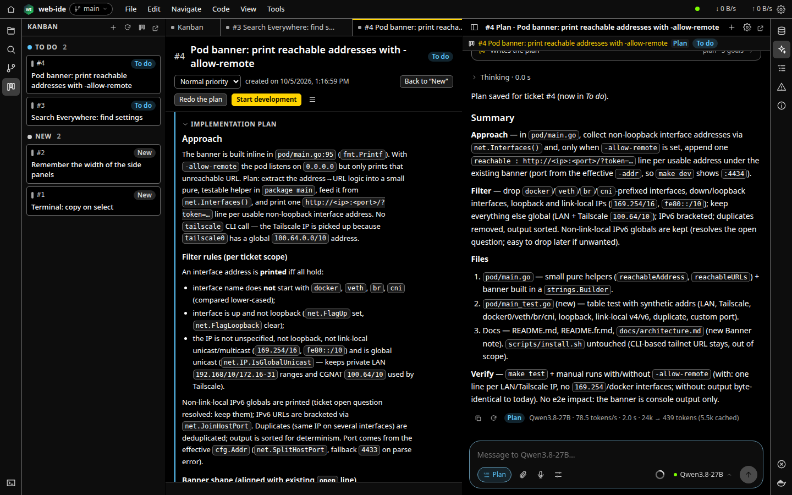
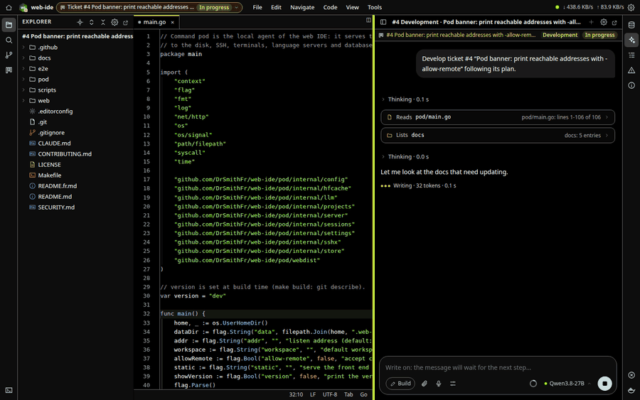
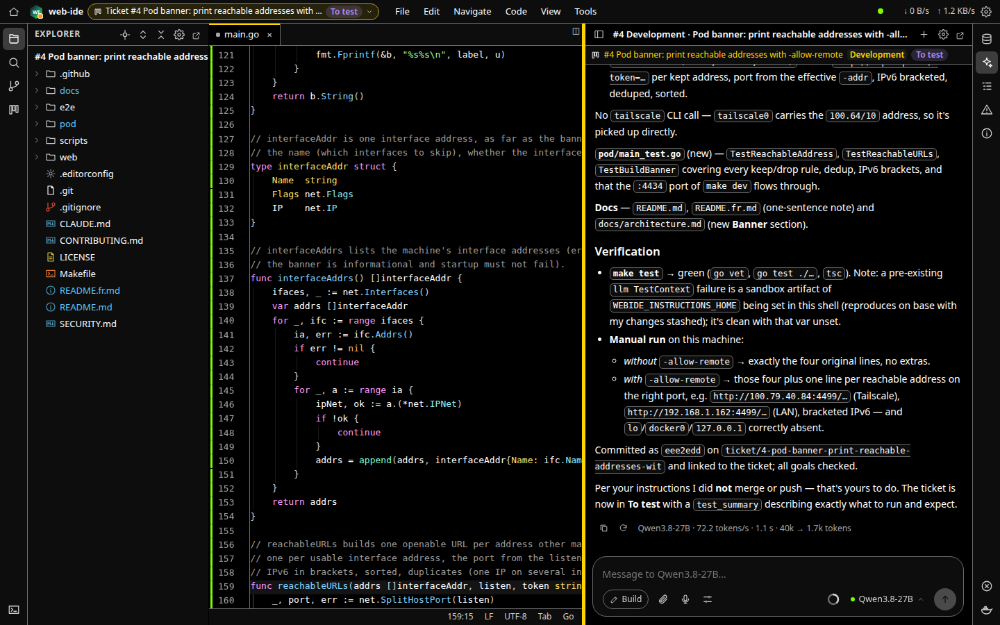
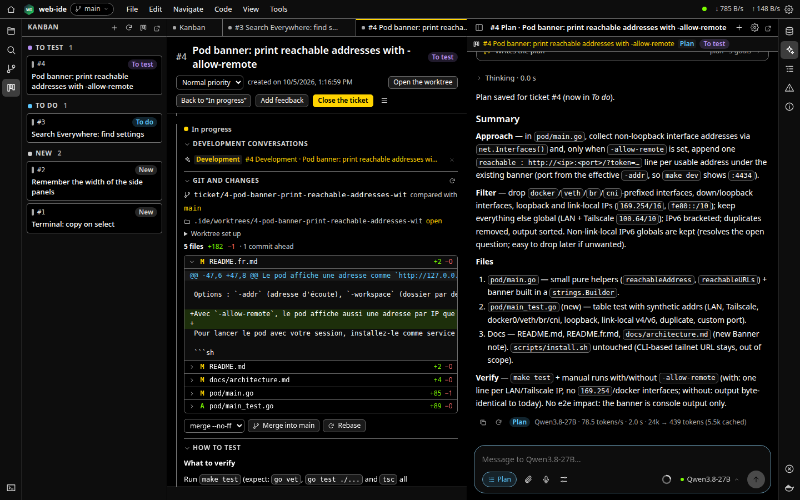
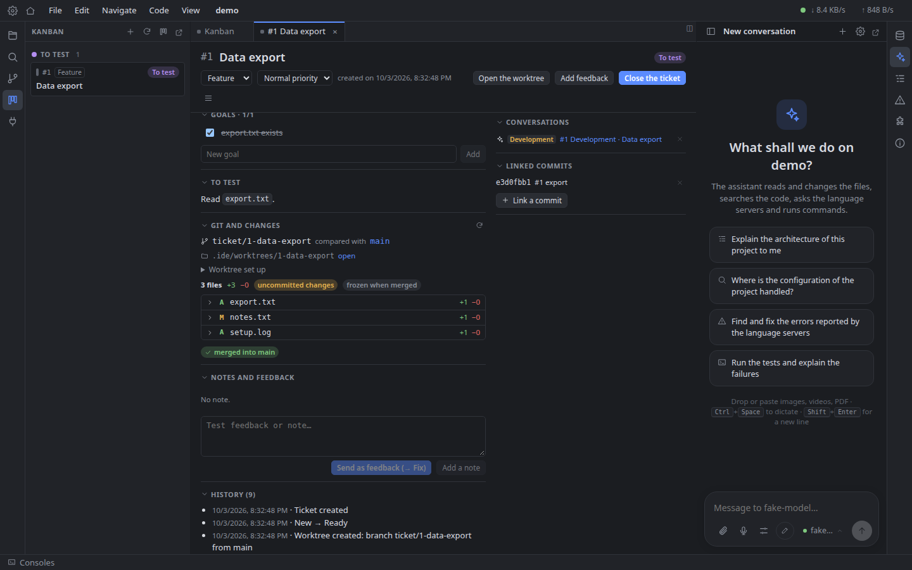
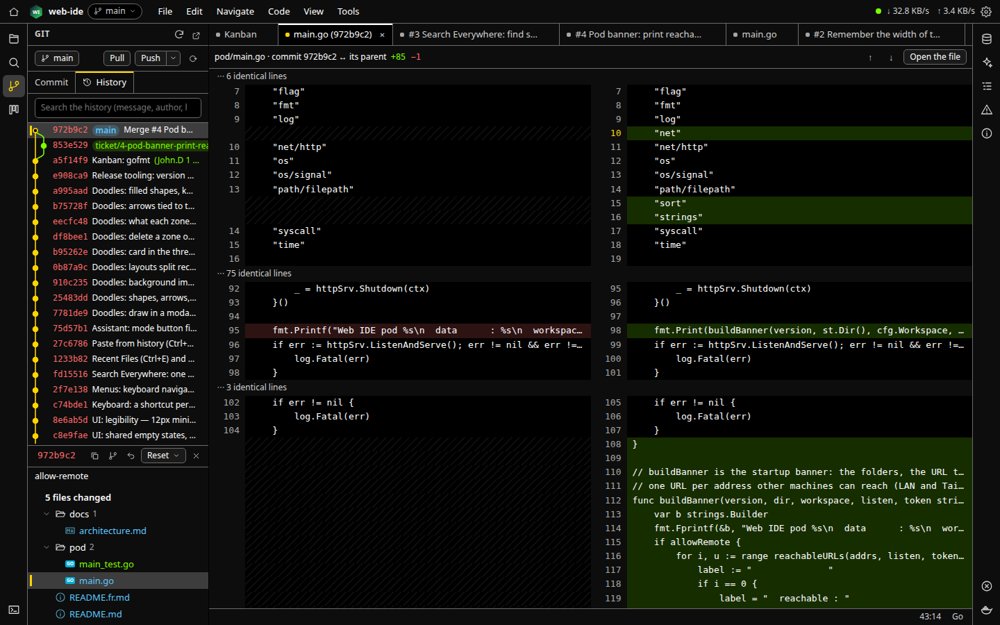
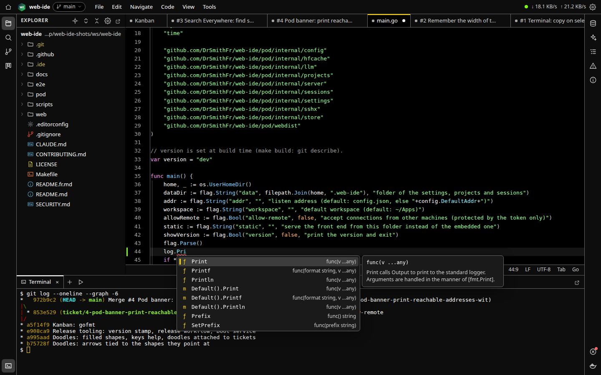

# User guide

How to install Web IDE, connect a model, and take a change from an idea to a merged branch with the assistant and the kanban. The pictures are made on this repository by `make shots` (see [Updating the pictures](#updating-the-pictures)).

- [Install](#install)
- [Projects](#projects)
- [Connect a model](#connect-a-model)
- [The development cycle](#the-development-cycle)
  1. [Briefing: from an idea to a ticket](#1-briefing-from-an-idea-to-a-ticket)
  2. [Plan](#2-plan)
  3. [Development in a worktree](#3-development-in-a-worktree)
  4. [Test, feedback, merge](#4-test-feedback-merge)
- [Working by hand](#working-by-hand)
- [Help](#help)
- [Where the data lives](#where-the-data-lives)
- [Updating the pictures](#updating-the-pictures)

## Install

Web IDE is one program, the **pod**, that serves the interface to your browser and does the work on your machine (files, git, terminals, language servers, model calls).

- [Linux](install/linux.md): the script installs the pod as a unit started at boot, optionally served on your Tailscale network.
- [macOS](install/macos.md): download the archive of the [latest release](https://github.com/DrSmithFr/web-ide/releases/latest) and run `./web-ide-pod`.
- [Windows with WSL](install/windows-wsl.md): the Linux install inside WSL 2, started at your logon.
- [From the sources](install/from-sources.md).

Then, as you need them: [account and devices](howto/account-and-devices.md), [pods on the local network](howto/lan-pods.md), [a relay to reach them from anywhere](howto/self-host-relay.md), [notifications on the phone](howto/notifications.md), [a new language](howto/add-translation.md), [changing the IDE itself](howto/modify-the-ide.md).

## Projects



The home page lists your projects and the folders of the projects folder not added yet: click one to open it. A project is a local folder or a folder on an SSH host (same features, through your local SSH keys). Each project gets an icon, generated from its name and editable.

A project opens in its own window, and comes back as you left it, in any browser connected to the same pod: tabs, splits, carets, terminals.

## Connect a model

The assistant talks to [llama.cpp](https://github.com/ggml-org/llama.cpp) (`llama-server`, also in router mode) or [Ollama](https://ollama.com), on your machine or on your network: open the assistant (right bar), *Add a model server*, give its address. Pick the model in the composer. Tool calling must be supported by the model and its chat template (`llama-server --jinja`).

A cloud provider (OpenAI, OpenRouter, any OpenAI-compatible API) is a server of type *OpenAI-compatible provider*, with its API key: the key stays on the pod. Type its models by hand when it does not list them. Marked *Available to sub-agents*, with a note ("strong at code, paid"), it lets your local model hand a task to a stronger one: the assistant picks it for a sub-agent, whose card shows its tokens and its cost. The default server of the sub-agents is in the *Sub-agents* tab of the settings.

The pictures of this guide are made with Qwen3.8 27B on llama.cpp.

## Agents: Claude Code, opencode, pi

The *Agents* tool (right bar) runs the coding agents installed on your machine in the IDE, through the Agent Client Protocol: Claude Code (with your subscription or API key, as in the terminal), opencode and pi. Open it, pick an agent: *Install* fetches a missing adapter (`npm`, into the data folder of the pod), opencode is installed by hand. Each session is a tab working in the project: type a prompt in the same box as the assistant (`@` for a file, `/` for the commands of the agent, files, images and doodles from the paperclip; Ctrl+Enter sends, a prompt sent during a turn waits for its end), follow its messages, tool calls and diffs, answer its permission cards and its questions, change its mode (the colored button, or Shift+Tab) or its model (at the right) under the box, as in the assistant. The options button holds its other settings (effort…); the ring shows the context used, and a click the work time and cost of the session and *Compact now*. The eye turns on the follow mode: each file the agent edits opens in the editor. A session keeps running when you close the window or update the pod; closing its tab ends it. The tooltip of a tab, the header of a ticket and the Infos tool show the work time and the cost of the agents (an *API equivalent* under a subscription).

To develop the tickets with one of them instead of the assistant, choose it as the *Development agent* in the kanban settings: *Start development* then opens its session in the worktree of the ticket, briefed with the ticket and its plan, with the kanban tools of the IDE at hand (goals, notes, *To test*). The ticket's *Open the session* brings it back.

When an agent needs you — a permission, a question of Claude, an `ask_user` — and its session is not on screen, the question opens in front of everything with what the agent said just before; *Later* leaves it in the *Questions* tool (right bar), which lists all of them. Turn *Open questions automatically* off at the top of that tool, or for one session from the menu of its tab.

## The development cycle

Each project has a kanban. A ticket goes through four stages, each one with its conversation of the assistant linked to it:

| Stage | What happens | Who |
|---|---|---|
| **New** | The need is clarified and written down | A *Briefing* conversation questions you and writes the ticket |
| **To do** | The implementation plan and its goals | *Generate the plan*: the model reads the code and writes them |
| **In progress** | The code, on its own branch and worktree | *Start development*: the model codes, tests and commits |
| **To test** | You check; feedback goes back to the model | You, then *Fix sessions*; finally merge and close |

You decide every move between stages; the model works inside one.

A new conversation starts in **Orchestrator** mode, your start page: ask it *what do we work on today?* (the tickets that can start, in order, with a button to start the first), *what did we do yesterday?* (the tickets that moved), or tell it *I have an idea…* (it opens a Briefing conversation with your idea). It changes no file and starts nothing by itself: you click its buttons. The default mode is set in the settings (*Prompt and instructions*).

### 1. Briefing: from an idea to a ticket



Open the assistant and switch it to **Briefing** mode (Shift+Tab cycles through Orchestrator, Build, Plan and Briefing). Describe the need in a few words. In this mode the model changes nothing: it reads the code to understand the context, then asks its questions, one at a time, with suggested answers:



When the need is clear, it writes the ticket (or several) on the kanban: description, acceptance criteria, linked files. The conversation stays linked to the ticket.

### 2. Plan



On the ticket, *Generate the plan* starts a conversation in Plan mode: the model reads the code concerned and writes the implementation plan and the goals, each with how to check it. The ticket moves to **To do**. Edit the plan or the goals if needed, or *Redo the plan*.

### 3. Development in a worktree



*Start development* creates the branch `ticket/<n>-<slug>` and a git worktree for it in `.ide/worktrees/`, runs the setup commands of the project in it (the Console commands flagged `setup`: `npm install`, copy a `.env`…), and shows it in the same window, where the model starts working:

- it follows the plan and the project instructions (`CLAUDE.md`, `AGENTS.md`, skills);
- it reads, searches, edits files, uses the language servers and runs commands (build, tests);
- it checks the goals one by one and commits on the ticket branch (messages start with `#<n>`);
- when done, it moves the ticket to **To test** with how to test it.

Your main folder is never touched: you can keep working there, or develop several tickets at once. Follow the work live, answer its questions, or stop and redirect it at any time.



### 4. Test, feedback, merge



In **To test**, the ticket shows how to test, the goals, and the change against its base branch, file by file. Test it in its worktree (the worktree selector of the menu bar; its files and terminals carry the chip `#<n>`). Then:

- **Add feedback** (bug, info or new feature) for what is wrong: *Fix session* sends one feedback or all of them to the model, which fixes them in the worktree and marks them handled.
- **Rebase** on the base branch when it moved; conflicts are listed with *Continue*, *Abort* and a *Resolution session* for the model.
- **Merge** into the local base branch (`merge --no-ff` or squash), or *Create the pull request* (with `gh`).
- **Close** the ticket: the worktree is removed, the branch is kept.

A big change can be split into a **lineage**: a first ticket, the **root**, and its **steps** (the briefing proposes it, or *Make it a step of…* in the *Lineage* section of a ticket). Each step is developed in the root's worktree once the previous one is validated (*Validate the step* on the root, *Close* on a step), and the root is merged once all its steps are finished. A ticket can also wait for another lineage to be merged; a blocked ticket shows what it waits for, and *Start anyway…* goes past it. The *Roadmap* view of the board shows the lineages as rows of blocks as wide as their size, so you see what can start and how big the work ahead is.





## Working by hand

Everything the model does, you can do yourself, in the same windows:



- **Editor**: splits, multiple carets (Alt+J next occurrence, Alt+Shift+drag or middle button for columns), folding, find and replace, Search Everywhere (Shift twice), Recent Files (Ctrl+E), the switcher (Ctrl+Tab), clipboard history (Ctrl+Shift+V). The back and forward buttons of the mouse move in the history of the focused part: positions and tabs of the editor (like Ctrl+Alt+Left/Right), console tabs, conversations of the assistant; they never leave the project. Tabs of files sharing a name show the folders that tell them apart (src/index.ts, lib/index.ts).
- **Language servers** (gopls, typescript-language-server, pyright, intelephense…, from the pod's `PATH`): go to definition, references, completion, rename, formatting, diagnostics.
- **Terminals** in the bottom panel (Ctrl+Shift+`), detachable in their own window.
- **Git**: changes, staging, commits, branches, history graph, side-by-side diffs, other worktrees.
- **Databases** (SQLite, PostgreSQL, Redis), **Docker** (Compose stack, containers, logs) and SSH port forwards.
- When a program (the model, a formatter, another editor) changes an open file, the change is merged into your buffer; a real conflict opens a three-pane dialog.

All shortcuts are in *Settings → Keyboard*, with QWERTY and AZERTY presets.

## Help

This documentation is inside the IDE, read only, and always the one of the version you run: *Help › Documentation* (also in the command palette) opens the index in a tab; links between pages, *Back* and the headings work as in a browser. A **?** next to a setting (Remote access, Notifications…), the kanban or the Agents tool opens the page that explains it, at its heading.

## Where the data lives

- `~/.web-ide/`: settings (with their history), projects, the state of the desks, model servers, secrets (mode 0600), the access token.
- `<project>/.ide/`: conversations (`chats.db`), kanban (`kanban.db`), worktrees of the tickets, database connections, folder marks, icon. The whole folder is ignored by git (its `.gitignore` is `*`); the worktrees use the `.ide` of the main project.
- Audio and private keys never leave your machine.

To work on Web IDE itself, `make dev` runs a separate pod (port 4434, data in `~/.web-ide-dev`) next to the installed one: see [CONTRIBUTING.md](../CONTRIBUTING.md).

## Updating the pictures

```sh
make shots                         # replays the recorded conversations
node e2e/shots/shots.cjs record    # records them again with a real model (LLM_URL, LLM_MODEL)
```

The scenario (`e2e/shots/shots.cjs`) clones this repository at the commit of the recording, drives the whole cycle above in headless Chromium, and writes the PNG and GIF files in `docs/images`. The answers of the model are replayed from `e2e/shots/recording.json.gz`, so the pictures can follow the interface without a model.
