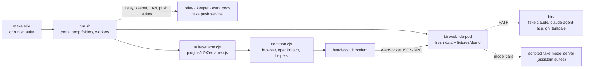

# `e2e`

Browser tests: Playwright core drives headless Chromium against a real pod, with the front end of `pod/webdist/dist`. Each suite is one script, in `suites/` for the core or in `plugins/<id>/e2e/` for a built-in plugin; `run.sh` starts what it needs (a pod with temporary data, sometimes a relay, a keeper, more pods) and runs it. Words are those of the [glossary](../GLOSSARY.md).

## Components

- `run.sh`: runs suites one by one or in parallel (`-j N` / `E2E_JOBS`, longest first, `perf` alone at the end). Each chain (a suite and the `+` ones after it) has its own temporary folder and block of 100 ports from `E2E_PORT_BASE` (21000: pod, +1 relay, +2 TURN, +3 push service, +20 LAN). The output of a failed suite is printed at the end, its pod log is in `/tmp/web-ide-e2e-<suite>.pod.log`. It does not build: run `make build` first.
- `common.cjs`: `start` (browser and page, English unless `E2E_LOCALE`), `openProject` and the helpers the suites share.
- `fixtures/`: `demo` is the projects folder copied for each suite, `other` a second one; `audio/` the speech sample; `home/` the home folder of the pod under test.
- `bin/`: fake `claude`, `claude-agent-acp`, `gh` and `tailscale` put first in the `PATH` of the pod.
- `shots/`: `make shots`, the pictures of the documentation, replayed from `recording.json.gz` (`shots.cjs`, `screencast.cjs`, `llm-proxy.cjs`).
- `suites/` and `plugins/<id>/e2e/`: one script per area, alphabetical, the plugin of a suite in brackets (`run.sh` has its own order, longest first, and refuses a suite file missing from it):

- `agent` [ai]: Assistant, features of the assistant: system prompt built from the editable template
- `agents` [ai]: Agents tool: ACP sessions with the fake agent of e2e/bin (claude-agent-acp): opened from the launcher, a prompt streams thought
- `chat` [ai]: Assistant, conversation features: side bar order, Ctrl+click on @file
- `commands` [exec]: Saved commands of the project: quick access of the empty Console, modal list + detail (bash editor), ▶ menu
- `desks`: Desks (docs/design/desks.md): each desk of a project has its own layout; the URL names the desk; two windows on two desks do not t
- `docker` [docker]: Docker tool against the local Docker: Compose stack of the project
- `doodle` [ai]: Assistant, doodles: paperclip menu, modal with the conversation, pen, marker under the pen
- `editing`: Editing: typing, undo, auto-indent, save, remote changes (merge, conflict), find bar, sub-words
- `editor` [code]: Editor: text against the gutter, indentation guides, whitespace, multiple carets, folding, soft wrap
- `explorer` [files]: File explorer: file type icons, click to select and double click to open, git colors (untracked, added, ignored), folder marks
- `features`: Navigation, splits, global search, terminal, palette, settings, SQLite explorer and console
- `git` [git]: Git tool: Commit tab (tree of changes with check boxes, diff, commit, commit and push), History tab
- `help`: Help: the docs embedded in the pod open read only from the Help menu and the palette; relative links, Back, anchors and pictures; the "?" of the settings, the Agents tool and the kanban at their headings; the tab after a reload
- `i18n`: Languages: a French browser gets the French interface; the language setting switches it at once (English, Spanish)
- `identity`: Identity (milestone 2): the pod makes an account from a 24-word phrase, browsers pair with the phrase or by an invite
- `kanban` [kanban]: Kanban: board, new ticket, ticket view by status
- `kanbanagents` [kanban]: Kanban and the Agents tool: with Claude Code as the development agent (kanban settings)
- `kanbanai` [kanban]: Kanban and the assistant: ask_user (questions one at a time, recap, answers sent back)
- `kanbangit` [kanban]: Kanban and git: development started from a ticket creates its branch and worktree
- `keeper`: Keeper: a terminal survives a restart of the pod (run.sh starts a keeper for this suite and gives the command restarting the pod)
- `keyboard`: Keyboard navigation: one shortcut per tool, Escape back to the editor, arrows inside toolbars and tab bars (one Tab stop per bar)
- `lan`: LAN (#50): the pods of one account reach each other on the local network with no relay
- `llm` [ai]: Assistant: server setup, model list, streamed answer with tool calls (read, language server, confirmed edit)
- `lsp` [languages]: Code navigation with gopls (skipped when gopls is not installed)
- `mcptools`: Tools of the IDE in its MCP (#68), called as a CLI agent does: a file and a diff opened in the window, a message
- `plugins`: Plugins (#113): the test plugin hello (`WEBIDE_TEST_PLUGINS`, set by run.sh) shows its tool last in its zone, answers through its backend and the MCP, and goes when disabled in Settings > Plugins (also after a reload); Docker (#114) disabled: its tool, its command and docker_ps go, its chunk is not requested after a reload (#124), the Port forwards and previews tool stays, and its tab comes back when enabled again; the Database explorer (#115) off and on keeps a console's text, an old desk is migrated; Exec (#116) off: no Console, Docker off for want of terminal, list_consoles refused, the terminals back with their output; Search (#117) off: no Search tool, no Text tab in Search Everywhere, Files still answers; Git (#118) off: no Git tool, a diff tab falls back, open_diff refused; Previews (#119) off (or Exec off): no tool, list_previews refused; Languages (#120) off: no Problems, Structure, Symbols tab nor code actions, the editor still edits; Files and Code (#121) locked, the Explorer colors from Git and its terminal item from Exec; Kanban (#122) off: no Kanban tool, a ticket tab falls back, kanban_list refused, the ticket back when on, and a ticket tab of an old desk migrated; AI (#123) off: no Assistant nor Agents, the MCP still answers but request_doodle, a briefing asked from a ticket says AI is off, back when on
- `externals`: External plugins (#128 to #131): its backend (`fixtures/greet-backend`, built by the suite) answers its frame and emits to it, reads the project but neither the pod's key nor the network, is refused fs.list by the core, and its assistant tool answers through the MCP; a git repository made by the suite, its release archives served by it; installed from Settings > Plugins with its permission accepted (the dialog, the lock, the extracted folder), used by the project (`.ide/plugins.json`): its tool in a sandboxed frame (`allow-scripts` only) where localStorage, IndexedDB, fetch (CSP) and the page are out of reach and a core method without its grant is refused; a file opened, a tab view with its state kept after a reload, Ctrl+Shift+A from the frame opens Search Everywhere, its command runs; updated to a version asking new permissions (only those asked again, the old version removed), up to date, a version for another IDE refused with its reason, removed (gone from the pod and from the project), installed again with fs.list granted: the frame gets its answer; a grant revoked in Settings is refused at once by the frame and the backend, answered once given again
- `mobile`: Phone layout (375×812, touch): one bar of three rows (project and status, the menus, the icons of the views)
- `mousenav`: Side buttons of the mouse (back, forward): they move in the history of the focused part, wherever the pointer is
- `multipod`: Multi-pod (milestone 3): three pods of one account, alpha and bravo on one cluster (they are linked by the LAN)
- `orchestrator` [ai]: Orchestrator mode, the default of a new conversation
- `perf`: Performance on a 100 000-line file: each keystroke and each scroll must fit in a few frames; the JS of the first load of a project window and of the home page, and their time (printed)
- `plan` [ai]: Assistant, Plan / Build modes: Shift+Tab, Plan prompt and tools (scratch files only, exit_plan_mode), dedicated Plan model
- `popups`: Popups: Search Everywhere (tabs over files, symbols, actions and text), Recent Files and the switcher, the clipboard history
- `preview` [previews]: App previews (share_preview): the model offers the app, nothing runs before the click; the click starts the command in a console
- `projects`: Projects: installable app, generated icon (home page, favicon), icon editor; menu bar with the selector of the worktrees
- `push`: Push notifications (relay milestone 6): a paired browser enables them in Settings > Notifications
- `questions`: Questions tool: a form of an ACP session (the fake agent's elicitation/create) opens by itself in a modal with the last message of
- `quota`: Quota (milestone 5): run.sh starts the relay with -quota 512KB (the home page alone is over it) and the pod with -force-turn, so every byte of the app crosses TURN
- `relay`: Relay (milestone 1): a browser on another network opens a project of a pod through the relay, and installs as an app (PWA)
- `renew`: TURN renewal (#86): run.sh starts the relay with credentials valid 10 s and the pod with -force-turn; the page renews them and restarts ICE on the same tunnel
- `restore`: Session restored after a reload (runs after features, same pod), detached windows
- `speech` [ai]: Local speech recognition: Whisper (tiny) in the browser, fed by a fake microphone playing e2e/audio/jfk.wav
- `subagents` [ai]: Sub-agents: the parent delegates with spawn_agent (a card in its thread); the child notes and asks; the parent
- `sync`: Settings sync (milestone 4): two pods of one account
- `forwards` [previews]: Port forwards of an SSH project (Docker tool, Port forwards tab) through the SSH server of the tests (sshtestd, built here): add, use

## Invariants and pitfalls

- A suite takes its ports from the `E2E_*_PORT` variables or `listen(0)`, and names what it creates outside its folder (Docker projects, volumes) after its pid, so that suites can run side by side.
- A suite name ending with `+` in `run.sh` reuses the pod of the previous one (`restore+` runs after `features`).
- The suites run without keeper, except `keeper` (`run.sh` starts one and gives it the script restarting the pod, `E2E_RESTART_POD`). Every pod but the ones of the `lan` suite runs with `-lan off`.
- Needs: `lsp` needs `gopls`; `docker` needs Docker with Compose and `postgres:17-alpine` (skipped otherwise); `speech` downloads `whisper-tiny` once; `forwards` builds `sshtestd`.
- **E2E tests** must wait actively (`waitForFunction`): language servers start cold. `<option>` elements are never "visible" for Playwright (`state: 'attached'`).
- **E2E suites that need the relay** (`relay`, `identity`, `sync`, `push`, `multipod`, `quota`, `renew`): `run.sh` starts the relay **before** the pod, else the pod fails its first dial and sits in exponential backoff; the suite waits until the pod is registered (the signaling path answers 404 before that).

## Tests

`./e2e/run.sh <suite>` for the area you changed (`make build` first), `make e2e` for all of them. More on building and testing: [architecture.md](../docs/design/architecture.md#building-and-testing).
