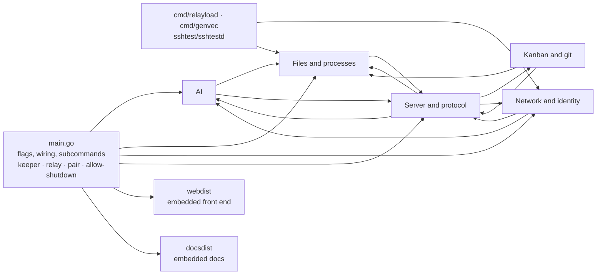

# `pod`

The pod: one Go binary that serves the front end and does the work on the machine (files, git, terminals, models, relay link). It is also the keeper, the relay and the pair command, chosen by the first argument. Words are those of the [glossary](../GLOSSARY.md); the system map is in [architecture.md](../docs/design/architecture.md#overview).

Arrows between blocks are imports of their packages, checked with `go list`; every block is a section of [internal/README.md](internal/README.md) with its own map. `webdist` is the front end built by Vite (`web/`), embedded with `go:embed` so the page and the WebSocket share one origin.

## Components

- `main.go`: flags, wiring and the subcommands: no argument runs the pod; `keeper` (the keeper, with `-upgrade`), `relay`, `pair create / restore / join / status`, `allow-shutdown`.
- `internal/`: the packages, in five blocks: [Server and protocol](internal/README.md#server-and-protocol), [Files and processes](internal/README.md#files-and-processes), [AI](internal/README.md#ai), [Kanban and git](internal/README.md#kanban-and-git), [Network and identity](internal/README.md#network-and-identity).
- `webdist/`: `embed.go` and the built `dist/` (git-ignored; `make build` fills it, and `make test` builds it first).
- `docsdist/`: `embed.go` and `content/`, a copy of the docs (`docs/`, `GLOSSARY.md`, the READMEs of the code, at their repo paths) made by `scripts/embed-docs.sh` (git-ignored; every `make` build and `make test` run it). `server/handlers_docs.go` serves it read only (`docs.read`, `docs.image`) to the Help of the window.
- `cmd/relayload`: the load tool of a relay; `cmd/genvec`: writes the identity test vectors shared with the JS module; `internal/sshtest/sshtestd`: the SSH server of the browser tests.

## Invariants and pitfalls

- **Shell**: never `pkill -x web-ide-pod` nor `pkill -f web-ide-pod`: the pod of the IDE (the service, which runs the assistant and its conversations) has the same name and dies with it, and `-f` also matches the keeper (`web-ide-keeper keeper`), which ends every terminal. Restart the pod with `systemctl --user restart web-ide-pod` only, and update the keeper with `web-ide-keeper keeper -upgrade`, never `systemctl --user restart web-ide-keeper`: a restart ends every terminal. Kill a test pod by the PID you kept (`$!`); `pkill -f <pattern>` also kills the command running it. Start a test pod with `setsid` / `< /dev/null`, otherwise a pipe stays open.
- Packages never import `server` except `relayclient` (it hands the DataChannels to `server.ServeTunnel`): a new package that needs the server takes an interface instead.
- Every message sent to the page goes through `i18n.Errorf` / `i18n.T`; every package that sends one imports `i18n`.

## Tests

`make test` (gofmt, `go vet`, `go test ./...`, `tsc`, the identity vectors, the links of the docs), or `cd pod && go test ./internal/<package>`. Browser tests: [../e2e/README.md](../e2e/README.md).
