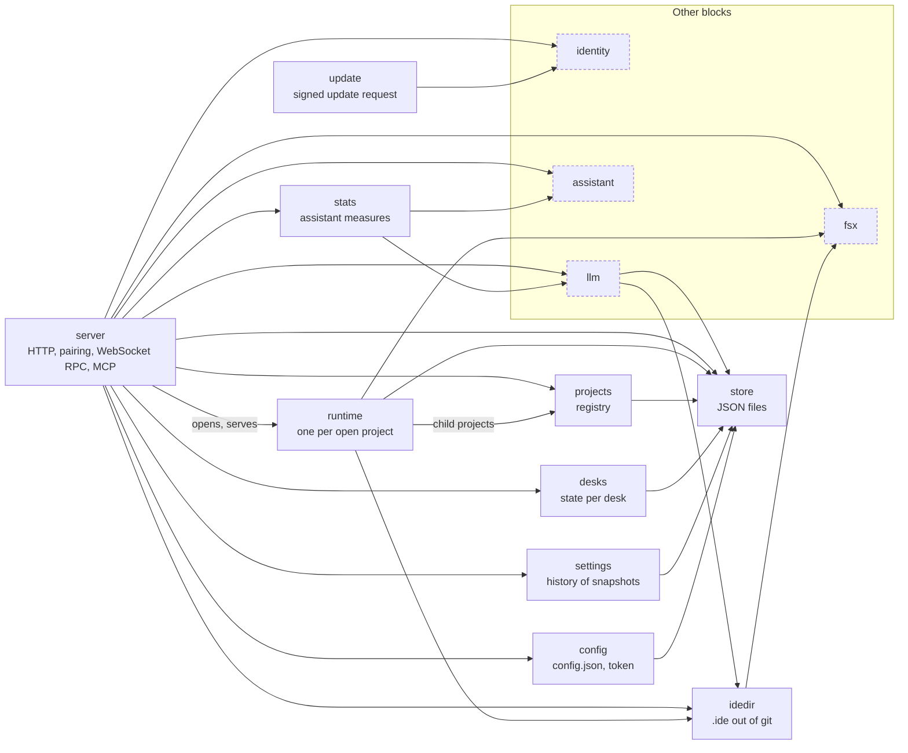
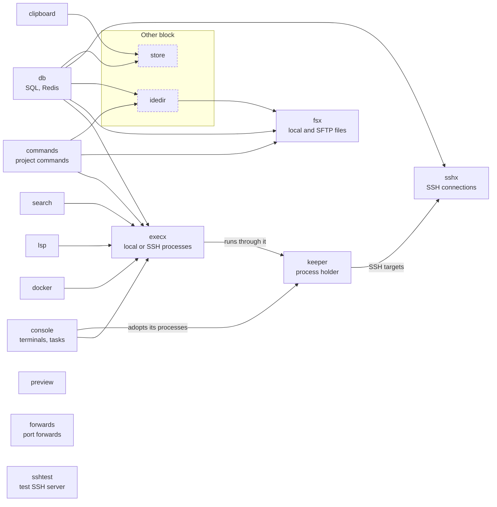
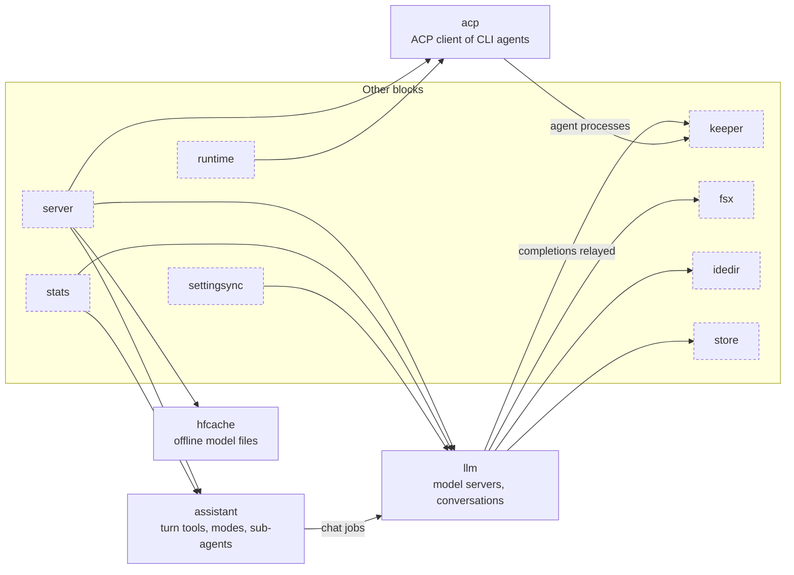
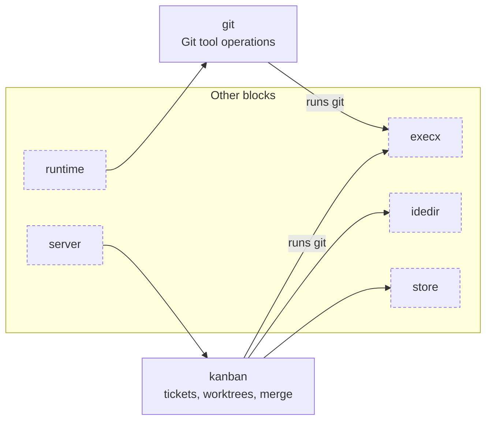
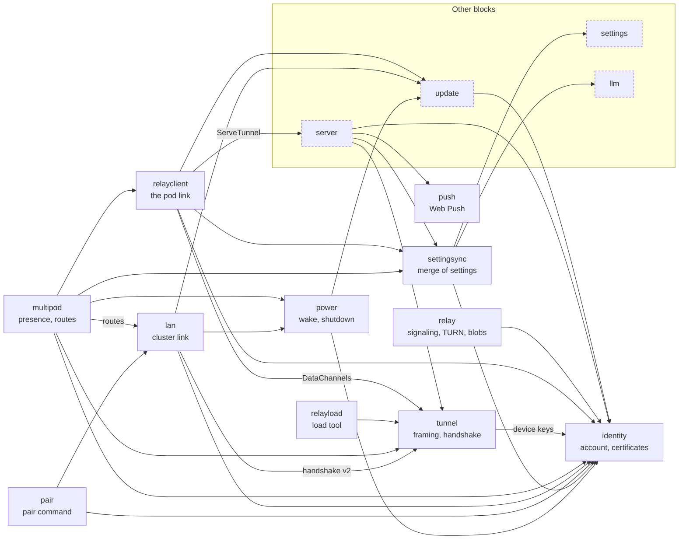

# `pod/internal`

The packages of the pod, in five blocks. Each section has the map of its packages (arrows are imports checked with `go list`), one line per package, and the invariants and pitfalls that belong to it. The pod as a whole, `main.go` and the order of the blocks: [../README.md](../README.md). Words are those of the [glossary](../../GLOSSARY.md).

| Block | Packages |
|---|---|
| [Server and protocol](#server-and-protocol) | `server`, `runtime`, `store`, `settings`, `projects`, `desks`, `idedir`, `config`, `stats`, `update`, `i18n` |
| [Files and processes](#files-and-processes) | `fsx`, `execx`, `sshx`, `sshtest`, `console`, `keeper`, `search`, `lsp`, `db`, `docker`, `forwards`, `preview`, `clipboard`, `commands` |
| [AI](#ai) | `llm`, `assistant`, `acp`, `hfcache` |
| [Kanban and git](#kanban-and-git) | `kanban`, `git` |
| [Network and identity](#network-and-identity) | `relay`, `relayclient`, `relayload`, `tunnel`, `multipod`, `lan`, `identity`, `pair`, `settingsync`, `push`, `power` |

Drawing conventions: dashed boxes belong to another block; edges to `i18n` (every package that sends a message to the page imports it) are not drawn. An edge label says what the call is for.

## Server and protocol

The core: the HTTP and WebSocket server, one runtime per open project, and the small stores (JSON files under `~/.web-ide`) the rest of the pod shares. `server` imports nearly every other package (its edges to the other blocks are on the [pod map](../README.md)): it is the only place where they meet.

**Packages**

- `server`: HTTP, pairing, WebSocket RPC; handlers per domain (`handlers*.go`); the Questions tool (`handlers_questions.go`: the questions of the ACP sessions of a root and its worktrees, of the assistant's conversations, of the MCP `ask_user` of `mcp_ask.go`, built when asked; `questions.changed` goes to the windows of the root, a new one is a push)
- `runtime`: One per open project: file system, watches, revisions, buffers shared between windows, consoles, LSP, databases, git, folder marks; text files decoded to UTF-8 with LF and encoded back in their format (`textfmt.go`)
- `store`: JSON files under `~/.web-ide` (the shared persistence of the pod)
- `settings`: IDE settings as an append-only history of full snapshots (`~/.web-ide/settings.json`); a rollback appends a copy of an older entry
- `projects`: Registry of the projects (`~/.web-ide/projects.json`), kept in memory; hidden child projects for the worktrees (`PutChild`, `PutWorktree`)
- `desks`: State of the desks of each project: open files, cursors, consoles, split layout, in `~/.web-ide/desks/<project>.json`; one file per desk (`desks.go`); the files of the former `sessions/` are moved there when read
- `idedir`: Keeps the `.ide` folder of a project out of git: its `.gitignore` is `*`, written whenever the pod writes there (`Ensure`)
- `config`: Pod configuration (`config.json`) and the access token
- `stats`: Measures how the assistant worked in a conversation: speeds, time generating, thinking and in each tool, failures of tools, context and compactions (token counts by part are estimates)
- `update`: *Update this pod*: what a pod does with a signed update request that reached it (`relay.md`, *Versions and updates*) — `identity.CheckUpdate`, then the installer run detached (`systemd-run --user` as the service, `setsid` otherwise)
- `i18n`: Translation of the messages sent to the page

**Tests**: `cd pod && go test ./internal/server ./internal/runtime ./internal/projects ./internal/desks ./internal/settings ./internal/store ./internal/config ./internal/idedir ./internal/stats ./internal/update ./internal/i18n`; e2e: `features`, `restore+`, `projects`, `desks`, `i18n`.

## Files and processes

What the pod does on the machine of a project, local or over SSH: files, processes, terminals, language servers, databases, Docker, port forwards, previews. `execx` and `fsx` hide the target (`local` or `ssh:<key>`); `keeper` holds the processes outside the pod (see the [architecture](../../docs/design/architecture.md#overview)).

**Packages**

- `fsx`: Local and SFTP file systems, watching (fsnotify or polling)
- `execx`: Local or SSH processes, PTYs
- `sshx`: SSH agent, keys, passwords, host keys (TOFU), connection pool
- `sshtest`: SSH server for tests (in memory; `sshtestd` runs it for the browser tests)
- `console`: Terminals and commands with scrollback and output offsets; run by the keeper when there is one, adopted again after a restart of the pod
- `keeper`: The keeper: protocol (frames of a length, a JSON header and raw bytes), server (processes known by pid and descriptors, output rings, attachments from an offset, GC of ended processes; HTTP relay of the completions; SSH connections; update by re-exec) and the client of the pod (reconnection, attachments resumed from their offset)
- `search`: Project-wide search (RE2) and file list
- `lsp`: Language servers per project and language
- `db`: SQLite (modernc), PostgreSQL (pgx), Redis (go-redis), SSH port forwards
- `docker`: Docker tool: status, Compose stack, containers, inspect, stats, log streams (the `docker` command, JSON formats only)
- `forwards`: Port forwards: local ports that reach an address seen from the SSH host of a project (open while a window of the pod is connected, closed `ForwardIdle` after the last one)
- `preview`: App previews: a reverse proxy per preview (cookie of the IDE, or the token of a public one), exposed by `tailscale serve` / `funnel` (`Tailscale` interface, faked in tests), stopped with the command of the app
- `clipboard`: History of the texts copied in the IDE, shared by every window
- `commands`: Saved commands of a project (`.ide/commands.json` of the main project): validation, load and save; run by the server (`commands.run`, `run_saved_command` of the assistant and the MCP, previews of `serve` commands) as tasks tagged with their id (`console.Info.CommandID`), one console per command; the `setup` ones make the setup script of a new worktree (`SetupScript`)

`sshtest` is the in-memory SSH server of the tests; `sshtest/sshtestd` runs it for the `forwards` suite. `lsp`, `search`, `docker` and `commands` run their commands through `execx`.

**Tests**: `cd pod && go test ./internal/{fsx,execx,sshx,console,keeper,search,lsp,db,docker,forwards,preview,clipboard,commands}`; e2e: `keeper`, `features`, `commands`, `docker`, `forwards`, `lsp`, `preview`, `popups`.

## AI

The assistant and the agents. `llm` talks to the model servers and keeps the conversations; `assistant` is what the assistant's turn loop needs apart from the server (the loop itself is `server/assistant*.go`); `acp` is the client of the CLI agents (Claude Code, opencode, pi), which run in the keeper. The way they interact is told in [architecture.md](../../docs/design/architecture.md#assistant) and [kanban.md](../../docs/design/kanban.md#claude-code).

**Packages**

- `llm`: Model servers, chat completions as jobs that survive the page, conversations (SQLite), instructions and skills
- `assistant`: What the assistant needs apart from the server: the stored conversation, the prompts and tool definitions, the Plan mode command rules, the line diff of a change, the questions of `ask_user`, the sub-agents (`subagents.go`); the loop itself is in `server/assistant*.go`
- `acp`: Agents tool: ACP client of the CLI agents (Claude Code, opencode, pi), one process per session in the keeper (piped, `sh -c 'exec "$@" 2>>log'` so that stderr stays apart) or in the pod without keeper; the JSON-RPC lines go through a queue per session (the reader of the keeper never waits); the thread built from `session/update` (`transcript.go`, the relative paths of tool calls made absolute from the cwd), saved with the output offset and the awaited prompt id so that the next pod follows the process again; a process that ends is restarted and `session/load`ed (3 ends in a minute stop it); the catalog finds the adapters in the `PATH` or `<data>/acp` and installs them with npm; each turn is timed (the open permissions apart) and recorded with its tokens per model in `turns.jsonl` (`stats.go`: Claude's `_meta.quota.model_usage`, opencode's `usage` and running cost, pi's session file through `~/.pi/pi-acp/session-map.json`), priced by `prices.go` (embedded table + `<data>/prices.json`) when summed; the context ring takes `usage_update`, and during a turn of pi or opencode (which tell it only at its end) `live.go` reads the tokens of the last step (pi's session file, opencode's `opencode.db` read only); `Agent.Hidden` adds the commands an agent runs without listing them (opencode's `/compact`); `Deps.MCP` is the MCP server of the IDE given to the agents that speak MCP over HTTP (`Server.agentsMCP`: the listen address, or `MCPBase` in tests); `prompt.go`: the content blocks of a prompt (text, `resource_link` per existing `@path`, images when `promptCapabilities.image`, texts), its images kept as files next to the session (`<id>/img-N`, served by `agents.image`) so the session file stays small, and the queue of the prompts sent during a turn (saved, sent by `endTurn` and after a start); the questions of the agent (`ask.go`): permissions and the forms of `elicitation/create` (declared in `clientCapabilities`: Claude's AskUserQuestion) are entries open until answered, withdrawn by `$/cancel_request`, cancelled by Stop, listed by `Manager.Questions` with the last agent message
- `hfcache`: Hugging Face files downloaded once and served offline (speech models)

**Tests**: `cd pod && go test ./internal/{llm,assistant,acp,hfcache}` and `./internal/server` (the loop, the MCP endpoint); e2e: `llm`, `agent`, `chat`, `plan`, `orchestrator`, `subagents`, `agents`, `questions`, `speech`, `doodle`.

## Kanban and git

Tickets and the Git tool. `kanban` keeps the tickets and the milestones (SQLite) and the git operations of a ticket (worktree, diff, merge, rebase); it runs `git` itself through `execx`, it does not import `git`. The development of a ticket by an agent is in `server/handlers_kanban_agent.go`; the workflow is in [kanban.md](../../docs/design/kanban.md).

**Packages**

- `kanban`: Tickets and milestones (SQLite), workflow rules, ticket git operations (worktrees, diff, merge, rebase); the development by an ACP agent is in `server/handlers_kanban_agent.go` (a session of the worktree's `acp.Manager` per ticket, `Info.Ticket`)
- `git`: Git panel operations

**Invariants and pitfalls**

- **Git**: git speaks the language of the user, so its messages are never parsed (`git.Show` asks `cat-file -e` first); ticket commits start with `#<n>`, so `rebase --continue` and `commit --no-edit` run with `core.commentChar=auto`; diff prefixes are forced (`--src-prefix=a/ --dst-prefix=b/`) because user settings such as `diff.mnemonicPrefix` change them; after a merge the branch has nothing left against its base, so the change is frozen in the ticket at merge time.

**Tests**: `cd pod && go test ./internal/kanban ./internal/git ./internal/server`; e2e: `kanban`, `kanbangit`, `kanbanagents`, `kanbanai`, `git`.

## Network and identity

Remote access and identity: the account and its keys, the relay and the pod link to it, the tunnel, the cluster of pods on the local network, pairing, synced settings, push notifications, power. The design is in [relay.md](../../docs/design/relay.md); the hosted relay and its costs in [load.md](../../docs/design/load.md). `multipod` imports `lan` and `relayclient`, so the numbers they share (the protocol version) are plain ints there.

**Packages**

- `relay`: Relay server (`web-ide-pod relay`): signaling routes, STUN/TURN (Pion TURN, UDP, TCP, TLS 443 demuxed by ALPN), SQLite base (`pods`, `usage`, `accounts`, `devices`, `pairings`), short-lived HMAC TURN credentials, the pairing and admin link (`identity.go`, `pairing.go`), bootstrap page and Service Worker (`web/`, `go:embed`), the manifest and icons of the pod's front end, Web Push (`push.go`: VAPID key, subscriptions `push_subs`, forwarding of the pods' ciphertext), the level of an account (`level.go`: the tier grid of the GitHub sponsorship and the VIP list `vips.go`, which set the TURN quota) the teams of the Team tier (`teams.go`: seats and members; `teamlink.go`: the admin proven with `read:org`, the team messages of the panel) and the admin commands `relay vip` / `relay team` / `relay supporters` (`admin.go`, relay.db only)
- `relayclient`: The pod's link to its relay: one outbound WebSocket with backoff, one PeerConnection per offer, DataChannels handed to `server.ServeTunnel`, the channels of a *window* of a browser (`@<key>/…`) handed to `multipod.Route`, and `Dial`, the pod acting as a browser to reach a pod of another cluster pod to pod (`dial.go`); `push.send` of the notifications
- `relayload`: Drives a relay with synthetic traffic over its own network protocols (HTTP, WebSocket, WebRTC), never its Go API, so it also runs against the hosted relay (`pod/cmd/relayload`; tiers: static, signal, tunnel; costs in [load.md](../../docs/design/load.md))
- `tunnel`: Message connections with framing and back-pressure (`MsgConn`, `Framed`), the channel-binding handshake (`handshake.go`): the token is proved inside the DataChannel, bound to both DTLS fingerprints, so the relay never sees it; version 2 signs the same binding with a device key (certificate mode)
- `multipod`: What the pods know of the other pods of the account: the presence the relay reports, the encrypted project lists merged into one home page (`pods.list`), the routes to a peer (`route.go`, `lan.OpenTunnel`), the remote gateway serving a pod of another cluster under `/_lan/pod/<key>/` (`remote.go`), and the multi-pod protocol this pod speaks (`version.go`)
- `lan`: The link between the pods of one account on the local network, with no relay (`relay.md`, *Local network*): a TLS port once paired, the handshake v2 bound to the TLS fingerprints, the control links that pass the revocation lists on, mDNS discovery (hashicorp/mdns) or addresses typed by hand, the page of each peer under `/_lan/pod/<key>/` (a reverse proxy pinned to its certificate), pairing over the LAN (`/_lan/join`) and the Devices link answered by the pod when it has no relay
- `identity`: Account from a BIP39 phrase (HKDF → account Ed25519 key, sync and device seeds), device certificates, revocation lists, verification of a peer certificate; the pod identity in the data folder (`device.key` 0600, `identity.json`); the embedded wordlist, the shared test vectors and the JS module served to the browser (`web/identity.js`)
- `pair`: `web-ide-pod pair create / restore / join / status` (phrase shown once, three words asked back, terminal QR, 4-word fingerprint, waits for an admin)
- `settingsync`: Merges the settings of the pods of an account: the relay stores one encrypted blob per account and kind, the pods merge by hybrid logical clock and ask the user only for an entry changed on both sides (`State`, `BlobRecord`)
- `push`: Web Push of the pod: RFC 8291 encryption (checked against the RFC example) and the subscriptions of the browsers (`push.json`); the events that notify are in `server/push.go`
- `power`: Wake-on-LAN, shutdown, reboot and restart (relay.md, *Power*): the cards a magic packet can wake and the packet itself (`wake.go`), the handler of a signed `PowerRequest`, and the polkit rule of `web-ide-pod allow-shutdown` (`allow.go`)

**Invariants and pitfalls**

- **Tunnel**: every message is framed into 16 KB fragments (Chrome caps a DataChannel message near 256 KB), so both sides must frame; a chunk sent to a queue must be **copied** (`channelWriter.Write`), otherwise a caller reusing its buffer corrupts the queued messages. The relay routes every signaling message by **session id** (one pod serves several browsers), and TURN credentials live 12 h: Pion re-checks expiry on refresh, a 5 min TTL kills a relayed tunnel. A handshake refusal must not close the DataChannel at once: the frame still queued in SCTP is dropped and the browser only sees the close, so it reads "the pod closed the connection" instead of "device revoked" — leave the refusal a moment to reach the peer, and on the page prefer the handshake error over the `bye` of the signaling link (the `bye` can arrive first).
- **Identity**: the canonical bytes a signature covers must be built the same way in Go and in JS (fixed field order, no spaces, the revoked keys sorted, the BIP39 checksum bit count by **integer** division), so the shared test vectors (`pod/internal/identity/vectors.json`) are run by `make test` in both languages. The JS module is imported at runtime by the bootstrap page and by the app, under the same path on both origins. WebAuthn extension outputs come from `getClientExtensionResults()`, never from `cred.extensions`; a passkey refuses an IP address as `rpId`, so `127.0.0.1` cannot hold one. A pairing code created by an admin is empty until the device that opens the invite link posts its key to it (`pairAttach`) — a code that already holds a key refuses another one.
- **Settings sync**: the canonical bytes of a blob, a wrap and a sync key record must be built the same way in Go and in JS (fixed field order, no spaces), which the shared vectors check. The edit kept while the debounced save waits is the **leaves it changed**, not the function that made it: a handler reads `e.currentTarget`, which is null once the event is over, and a deferred call then throws before the save is sent. The clocks are **hybrid logical**, never wall time alone: a pod that trusts its clock alone overwrites the other pods when its clock is ahead. A pod with no wrap has no key and must not write, else it replaces the stored blob with its own view; it pulls as soon as the wrap arrives, and a wrap of another epoch means a pull again (the stored blob was encrypted with the key of the epoch the pod cannot open). A merge must keep the paths it does not know: an older pod would drop a field it never saw. Every applied remote change goes through `Settings.Save` with a label, so the history of the settings keeps the changes of the other pods. The device id of a browser is its certificate key id, which `localhost` cannot have (no passkey there), so a browser on `localhost` keeps a random id in `localStorage`.
- **LAN link**: an unpaired pod opens no LAN port (the listener starts when `identity.json` gets an account, read again by `PodIdentity.Refresh` when the pair command changes it under a running pod). Every e2e pod but the ones of the `lan` suite runs with `-lan off`, else a paired test pod would take `:4436` from the IDE's own pod; the `lan` suite types the addresses (`-mdns=false`) and starts its extra pods itself. The gateway keeps the `Host` of the browser (the peer's WebSocket checks the origin against it), drops the cookie and strips the prefix; the peer gets the prefix in `X-Webide-Base` (trusted on its LAN port only) and serves `index.html` with its assets under it (the front end is built with Vite `base: './'`, its paths go through `podPath()` of `web/src/app/base.ts`). Two pods restored from one phrase share the admin device key: a second pod joins with `pair join --phrase` (its own key).
- **Bootstrap page** (`relay/web/bootstrap.*`): its views are built from DOM nodes, never from HTML strings (pod names and relay messages are not ours to trust), and its styles are a file of their own (`/_relay/bootstrap.css`), so a strict CSP fits. The identity link drops a message nobody waits for: the first `pods` list can arrive while the page still writes the revocation list to IndexedDB, so `onPush` keeps it (`firstPods`) — waiting for another one hung every account that had a revocation list. The unlocked session lives in its own database (`webide-session`): the one of the devices keeps its version, which an older copy of `identity.js` served by a LAN pod must still open.
- **Multi-pod**: the relay is never trusted for identity — it says who is online and where, nothing else. A `register` (pod link or identity link) is a proof of possession of the key the certificate names, bound to the relay origin (`identity.RelayBinding`), so a copied certificate registers nothing and a device that proves nothing gets no presence, no cluster and no gateway role. A relayed blob keeps the signature of the device that wrote it: a peer forwards `BlobRecord` **unchanged**, so the hop adds no trust rule and the relay still checks the origin. The published list is the **state envelope** of #28 (`settingsync.State`), not the list itself: a reader projects it before decoding it, and the projects source declares no map field (one writer per kind, nothing to merge). The `projects:` kinds are sources of the hub but not a switch: the hub keeps them out of `sync.status` and its events, else the Sync panel shows a third "settings" row. Election: `since` is reset only by a clean `bye` (a dropped link keeps the role 10 s), so an unstable link cannot flap the gateway. The home page lists the LAN peers first — they work with the relay down and their page is served under `/_lan/pod/` — so `pods.list` must be refreshed when a peer connects or drops, not only when the relay answers.
- **Routing to every pod** (#59): one origin, so the *base* of a page is what tells a pod which prefix to answer — `basePattern` accepts `/_lan/pod/<key>` **and** `/pod/<key>`, and the base must travel with the request: `X-Webide-Base` is trusted from the LAN port and from the tunnel only, so the bootstrap puts it in the JSON head of every `http:<n>` channel (`server.httpRequest.Base`), and `serveHTTPChannel` puts it in the request context the same way `ServeTrusted` does. `/_lan/pod/` arriving **on a tunnel** is not a static file: `httpHandler` routes it to `lan.ServeGateway`, which proxies to the peer (or, for a key that is not a LAN peer, to `multipod.RemoteGateway`, which dials it pod to pod). A routed channel is **the browser's handshake, not the gateway's**: the gateway vouches for the window with the certificate it verified (`X-Webide-Via` on `/_lan/tunnel`, `via` in the `$hello` of `Dial`) and the end pod rechecks it against **its own** revocation list — a browser revoked while a tunnel through the gateway is open must be refused by the pod at the end of the chain, not only by the gateway. The relay must say `byePod` to the browser windows of a pod whose link ended (`servePod` defer), else the bootstrap keeps a dead window id and never re-routes. On the page side: a DataChannel is not open when `askPort` answers, so the messages queued before `open` must be flushed **on the open event** (a big first request, 1.5 MB on `xfer:<n>`, is lost otherwise); one `@<key>/rpc` channel per routed pod per window, so two pages of the same pod share it; and the routing decisions are pure functions of `relay/web/routes.js` (imported by the bootstrap and run by `node --test scripts/routes-test.mjs`), because re-routing a LAN-only page to a new gateway needs a fourth pod in the e2e (the cluster id moves when a pod joins or leaves, so `entryCluster` must follow the pods list, and the failover must look for a pod of the **cluster** it entered, not for any gateway). A side rpc channel of another pod is labelled `rpc:push`, not `rpc`: a second `rpc` DataChannel on a pod's own tunnel is never served (`relayclient` feeds its single `session.rpcCh`). A push subscription is repeated on every pod of `pods.list` and kept in `localStorage`, and an idle tunnel is closed after 2 min — so a page that comes back later asks a fresh one.
- **Protocol versions and updates** (#60): the protocol number travels on three transports (the LAN `$info`, the relay `register`, the `projects:` list) and on the `pods` presence, so `lan` and `relayclient` carry it as a plain int — `multipod` imports them, and a shared type there would close an import cycle; `multipod.Protocol` is the one value to bump when the shape of any of them changes. A cluster is elected under the protocol the **majority** of its pods speak (the highest on a tie), so one old pod never drags a cluster back, and a pod of another protocol is neither a gateway nor a route (`Directory.GapOf`, `Routeable`, `lan.ServeGateway`, `lan.OpenTunnel`, `relayclient.Dial`). The update request is canonical JSON with a fixed field order kept in the **shared** vectors (`identity/vectors.json`, `updateCanonical` / `updateSig`): the browser signs it and the pod verifies those bytes. The relay is a **carrier, not a verifier** — it checks who is online and of which account, and rewrites the id of the request to a hop id of its own, so a pod that is not the one the request names cannot answer `running` for it. The target pod does every check (`identity.CheckUpdate`: the pinned account, the revocation list, the freshness, the release tag, its own device key) and remembers the signatures it already ran, so a replay on a link that stayed open never restarts it twice. The installer must run **outside** the process group of the pod (`setsid`, `systemd-run --user`): the install restarts the pod, and a child of the pod would be killed by that restart before it finished. `WEBIDE_UPDATE_CMD` stands for the installer in the tests, and `-pod-version` lets a build of the source tree stand for a release (no pod installs a development version, so the button would never show). `install.sh` copies itself next to the binary it installs (`~/.local/lib/web-ide/install.sh`): the pod has no way back to the folder the user ran it from.
- **Power** (milestone 7): the power request is the update request with an action, so it shares its checks, its carriers (`lan.carry`, `relayclient.carry`, the hop ids of the relay) and its answer type (`power.Answer` is `update.Answer`). A wake is the one request whose target cannot check it: the pod that sends the packet does, and the relay fans it out to every other pod of the account (`relay/power.go`, `wakeFan`), passing back the first `sent`. The cards and the rule travel in the published list and in the LAN `$info` as optional fields (`wake`, `power`; a LAN-only pod may publish no list the others read, and `$info` is sent when a link comes up only): absent, the page offers nothing, so no protocol bump. Shutdown and reboot run one second after the answer (`Handler.Delay`), else the page never hears it. `127.255.255.255` is a broadcast route of the loopback on Linux, which is how the tests send a real packet (`WEBIDE_WAKE_IFACES=mac@127.0.0.0/8`, `WEBIDE_WAKE_PORT`).
- **Levels** (#87): the CLI writes `relay.db` from another process, so the relay polls `PRAGMA data_version` — on a connection **held** for it (`db.Conn`), since the value is per connection and two connections of the pool do not compare. The relay's own writes move it too (the TURN usage each minute), so a change only recomputes the levels and tells the accounts whose level differs. The level hook of TURN is the store's (`Store.Level`), not the GitHub side: a relay with no GitHub app still has VIPs by account id.
- **Service Worker of the relay**: install the stream handler *before* waiting for the HTTP head, otherwise the chunks arriving between the head and the handler are lost; the bootstrap page and `sw.js` themselves must not be answered from the pod (the tunnel is not open yet when the page loads). Preview apps that open their own WebSocket (HMR) cannot go through the Service Worker. Through the tunnel the `hello` event of the pod reaches the bootstrap page before the app listens: the app never sees `pod.connected` there (a request sent early waits in the queue of the connection).

**Tests**: `cd pod && go test ./internal/{relay,relayclient,relayload,tunnel,multipod,lan,identity,pair,settingsync,push,power,update}`; `node scripts/identity-vectors.mjs` (the vectors shared with the JS module); e2e: `relay`, `identity`, `sync`, `push`, `multipod`, `lan`, `quota`.
