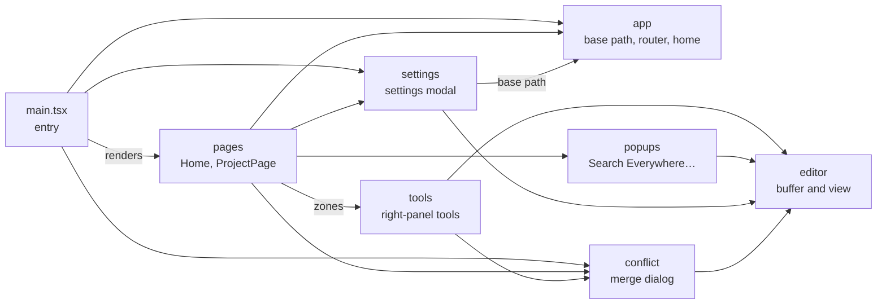
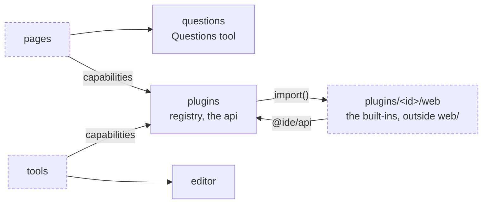

# `web/src`

The front end of the IDE, in the words of the [glossary](../../GLOSSARY.md): a window shows one project on one desk, made of tools in the tool zones around the editor area. State lives in module-level Solid signals and stores; everything the pod knows arrives through `pod/` (JSON-RPC and pushed events), and the pod is the only writer of shared data (files, sessions, conversations, tickets).

**The window**

**Tools and plugins**

Diagram edges are imports of the folders, checked with a script over the `import` lines. Nearly every folder also imports `state`, `pod`, `ui`, `keys` and `i18n`: those edges are not drawn. There is no strict layering: `ui` imports `plugins` and `popups` (the editor area hosts them), `state` imports `plugins`, `settings` and `ui`. Modules therefore keep their top level free of calls into another folder. The built-in plugins (`plugins/<id>/web`) import only the plugin API.

## Components

- `main.tsx`: entry (mounts `pages`, wires the keys and the pod connection); `styles.css`: global styles and the themes' variables.
- [`app/`](app/): `base.ts` (the path the page runs under: empty on its own pod, `/_lan/pod/<key>` or `/pod/<key>` through a gateway), `router.ts` (`/`, `/project/:id`, `/project/:id/desk/:n`, detached panels), `home.ts` (one home page for the whole account)
- [`pod/`](pod/): The pod as seen by the page: `rpc.ts` (requests, pushed events, reconnection), `transport.ts` (WebSocket, or a MessagePort to the bootstrap page through a tunnel), `remote.ts` (requests to another pod from the home page), `power.ts`, `update.ts` (signed requests), `push.ts`
- [`state/`](state/): Open project and session (tabs, split tree, tool zones), settings, git state, folder marks, the phone layout (`mobile.ts`: the view shown, the keyboard, no zoom)
- [`pages/`](pages/): `Home`, `ProjectPage` (menu bar, rails, side panels, editor area, bottom tools), `ProjectBar`, `Detached` (one panel alone)
- [`ui/`](ui/): Editor area (it renders the file tabs with the `fileView` of Code), the text editors of the window (`textEditors.ts`), file type icons (`fileIcons.tsx`), ANSI colors of an output (`ansi.ts`), rendered Markdown (`markdown.ts`, `Markdown.tsx`) and Markdown files (`MarkdownView.tsx`), the diagrams in full screen (`DiagramViewer.tsx`), the interface tools a window runs for the pod (`uiCalls.ts`: `ui.call`, open a file, a diff, focus a panel…; a plugin adds its own) and the embedded docs (`DocView.tsx`, see `help/`), status bar (a shell: the desks of `DeskSwitcher.tsx` on its left, the items of the focused tab or tool given by the plugins on its right), diff view (its sides from the diff sources of `diffSources.ts`), overlays (modal, prompt, pick list, context menu), toasts, icons, empty states, keyboard navigation of the toolbars and tab bars (`roving.ts`)
- [`editor/`](editor/): `Doc` (buffer, revisions, undo, file format, indentation), the completion widget's helpers (`completion.ts`: the items of the `language` service or the words of the buffer) and LSP text edits (`textEdits.ts`), `EditorView` (block rendering, Custom Highlight API, indentation guides, whitespace overlay, multiple carets, folding, soft wrap with rows read from the layout), `carets.ts` (words, occurrences), `folding.ts` (fold ranges), `indent.ts` (indentation detection), tokenizer and grammars, three-way merge, line diff, sub-word moves, find bar
- [`keys/`](keys/): Binding table and QWERTY / AZERTY presets
- [`help/`](help/): `topics.json`, the map from a place of the interface to a page of the docs (`path#heading`, checked by `make test`), and the `HelpLink` (**?**); the pages open in `doc` tabs (`ui/DocView.tsx`, `state/docs.ts`)
- [`popups/`](popups/): Search Everywhere (a shell: a tab per search provider of `searchProviders.ts`, the files, symbols and actions given by the core), Recent Files and the switcher, paste from history (the history itself: `ui/clipboard.ts`)
- [`tools/`](tools/): The Conflicts tool (`tools.tsx`) and `InfoTool`
- [`conflict/`](conflict/): Three-pane conflict dialog
- [`settings/`](settings/): Settings modal and its pages: `Members`, `Lan`, `Pods`, `Sync`, `Notifications`, `Plugins` (with a project open) (remote access and account), themes (`themes.ts`)
- [`questions/`](questions/): Questions tool: the list (`state.ts`, asked again on `questions.changed`), the modal one question at a time and its auto-open (not for a question whose thread is on screen: `showsQuestions`), the forms of `elicitation/create` (`Form.tsx`, also in the Agents thread), the card of `ask_user` (`AskCard.tsx`, its widgets `AskTypes.tsx`, its logic and types `ask.ts`), shared with the assistant
- [`plugins/`](plugins/): The plugins of the window ([plugins.md](../../docs/design/plugins.md)): `registry.tsx` (the states sent by the pod in `project.open` and `plugins.changed`, the page modules of the built-ins, each a chunk `plugin-<id>` loaded by `import()` when first enabled and activated once, a placeholder meanwhile, their tools, tab views `plugin:<id>/<view>` and commands), `api.ts` (the `api` a module gets: `rpc` to its backend, events, `openFile`, `openView`, port forwards and previews of the core, `ui`), `types.ts`, `capabilities.ts` (capabilities as services: the types of `terminal`, `commands` and `git`, `provide` by a plugin, `capability()` for the core, `undefined` while the provider is off); the built-ins are not here: each one is `plugins/<id>/web` at the root of the repository (its [README](../../plugins/README.md)). The tools of the enabled plugins join `toolPanels` (`pages/ProjectPage.tsx`) and the tiles; their default zone comes from `state/zones.ts` (`setPluginZones`), which keeps the place of a disabled one
- [`i18n/`](i18n/): `t()` and the catalogs (English source strings, `languages.json`, one catalog per other language)

## Invariants and pitfalls

- **Solid empties a container** whose only child is dynamic: a node mounted by hand (the editor view) needs its own element (`.editor-mount`).
- **View callbacks run under `untrack`** (`useEditorView`), otherwise an effect calling `setSelection` subscribes to what the callback reads.
- **Editor blocks use `width: max-content`**, otherwise lengthening the longest line re-lays out the whole file.
- **Editor rows are not lines** once something is folded: positions go through `lineTop` / `lineAtY` (`rowOf`, `lineOfRow`), never `line * lineHeight`. Folding splits a block (`splitText` then a move to a new element), which loses the DOM selection: it is set again afterwards.
- **The editor overlays share the global CSS**: a class such as `.tab` (editor tabs) also styles an element of the whitespace overlay; overlay elements use short editor-specific names.
- **The browser draws no caret at the end of a non-empty selection**: with several carets the editor hides the native caret and draws them all.
- **`caretPositionFromPoint` at the left edge** of the text can land in the gutter: `offsetAt` keeps the point inside the content.
- **No `push(...bigArray)`** (stack overflow on large pastes): copy in a loop.
- **A Solid store merges objects**: `setChat('running', {})` clears nothing; write `{ stream: undefined }`.
- **DOMPurify** drops attributes containing `-->` (Mermaid sources are stored URI-encoded) and HTML inside `foreignObject` (Mermaid uses `htmlLabels: false`).
- **Copy through `copyText`** (`ui/clipboard.ts`), not `navigator.clipboard.writeText`: the text then goes to the clipboard history. A popup gives the focus back with `keepFocus` (`state/focus.ts`): focusing the editor again puts its caret at the start otherwise.
- **Side buttons of the mouse** (`keys/mouse.ts`): cancelled on `mouseup` (Chromium goes back in the browser history otherwise) and sent to the focused part (`focusPart`, which they do not change): `navigate` of `state/project.ts` (positions and tabs, recorded by `openFile`, `openTab` and `activateTab`), `navigateConsoles`, `navigateChats`.

## Tests

`cd web && npm run check` (tsc and the catalogs); browser suites ([../../e2e/README.md](../../e2e/README.md)): `editing`, `editor`, `features`, `explorer`, `popups`, `keyboard`, `mousenav`, `mobile`, `desks`, `llm`, `kanban`, `perf` and the others by tool.
